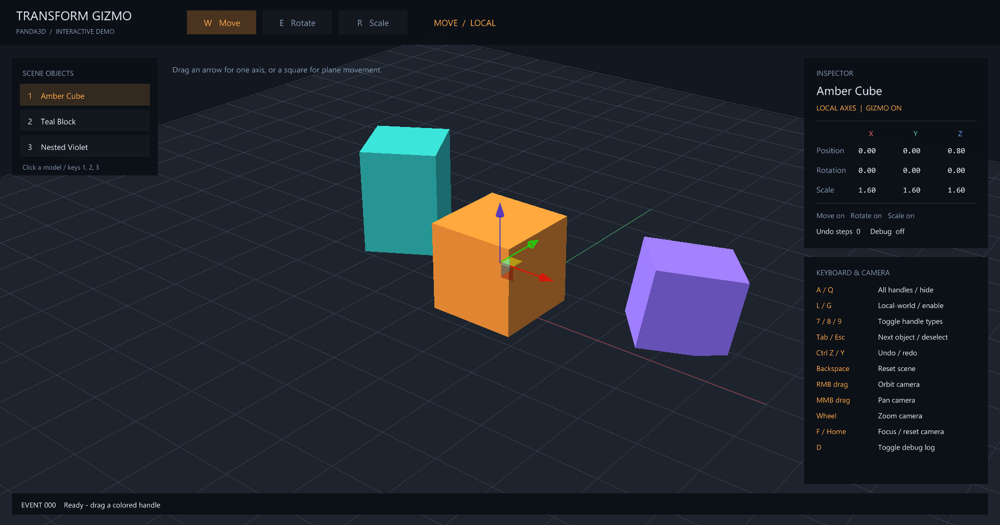
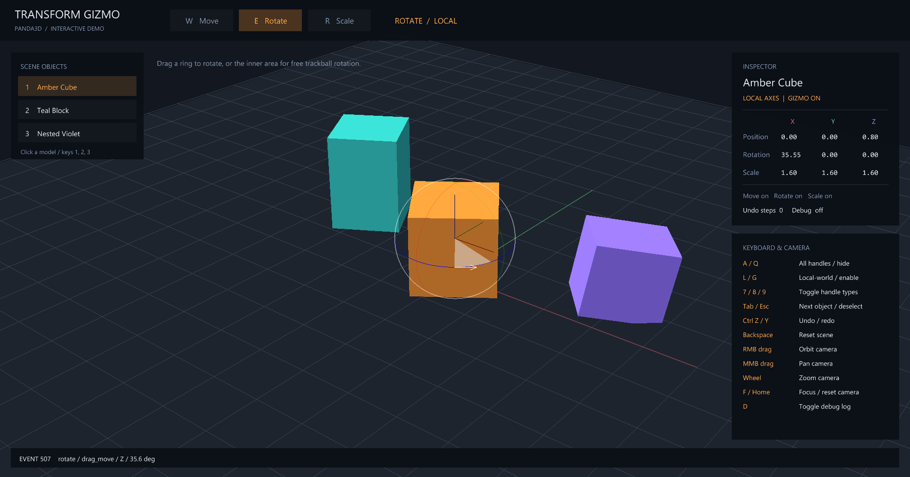
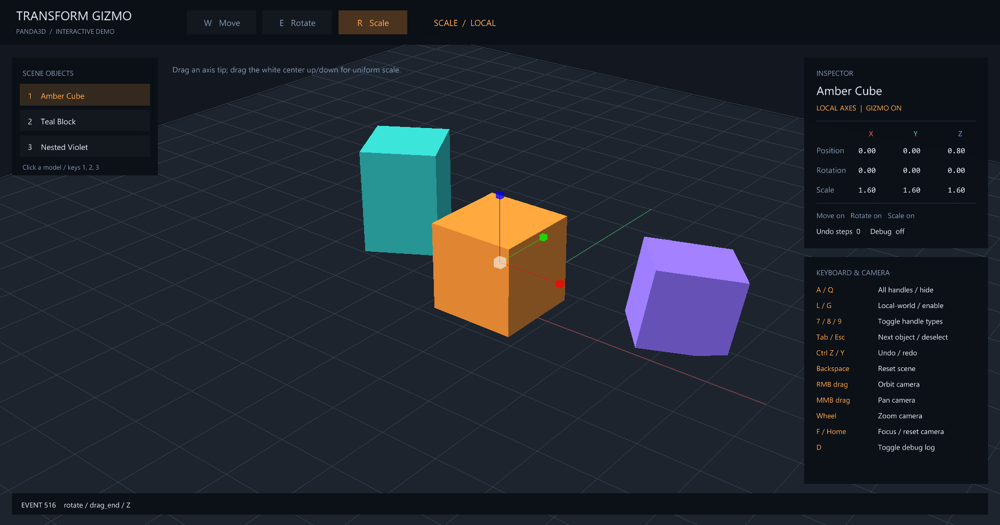

# Panda3D Transform Gizmo

适用于 Panda3D 的交互式变换控制柄，支持移动、旋转和缩放。控制柄由代码生成，可直接操作场景中的 `NodePath`。

**Python 3.10+ · Panda3D 1.10.16–1.10.x**

## 预览

| 移动 | 旋转 | 缩放 |
| --- | --- | --- |
|  |  |  |

## 运行演示

```bash
git clone https://github.com/skir95105-zh/panda3d-transform-gizmo.git
cd panda3d-transform-gizmo
python -m venv .venv
```

Windows PowerShell：

```powershell
.\.venv\Scripts\python.exe -m pip install -r requirements.txt
.\.venv\Scripts\python.exe demo.py
```

Linux / macOS：

```bash
.venv/bin/python -m pip install -r requirements.txt
.venv/bin/python demo.py
```

演示包含可交互场景和控制面板。场景选择、镜头操作等演示功能由 `demo.py` 实现，并非插件接口的一部分。

## 在项目中使用

克隆仓库后，在宿主项目的 Python 环境中安装：

```bash
python -m pip install /path/to/panda3d-transform-gizmo
```

创建 `ShowBase` 和目标模型后，绑定模型的 `NodePath`：

```python
from direct.showbase.ShowBase import ShowBase
from TransformGizmo import TransformGizmo, TransformGizmoMode

base = ShowBase()
model = base.render.attachNewNode("target")  # 替换为你的模型 NodePath

gizmo = TransformGizmo(base)
gizmo.set_mode(TransformGizmoMode.MOVE)
gizmo.attach(model)

try:
    base.run()
finally:
    gizmo.destroy()
    base.destroy()
```

默认提供 `W/E/R` 模式切换和 `Ctrl+Z` / `Ctrl+Y` 撤销重做。常用接口：`attach()`、`detach()`、`set_mode()`、`set_local()`、`set_enabled()`、`undo_last()`、`redo_last()`、`destroy()`。完整事件与参数说明见[事件文档](TransformGizmo/docs/transform_gizmo_events.md)。

## 支持范围

- 移动支持轴向和平面拖动；旋转支持轴环与轨迹球；缩放支持单轴和均匀缩放。
- `L` 切换移动/旋转的局部与世界坐标；缩放沿物体局部轴。
- 缩放倍率下限为 `0.01`。暂不支持吸附、多选、剪切或拖拽镜像。
- 建议每个交互视口使用一个 `TransformGizmo` 实例。

## 许可证

[MIT](LICENSE)
